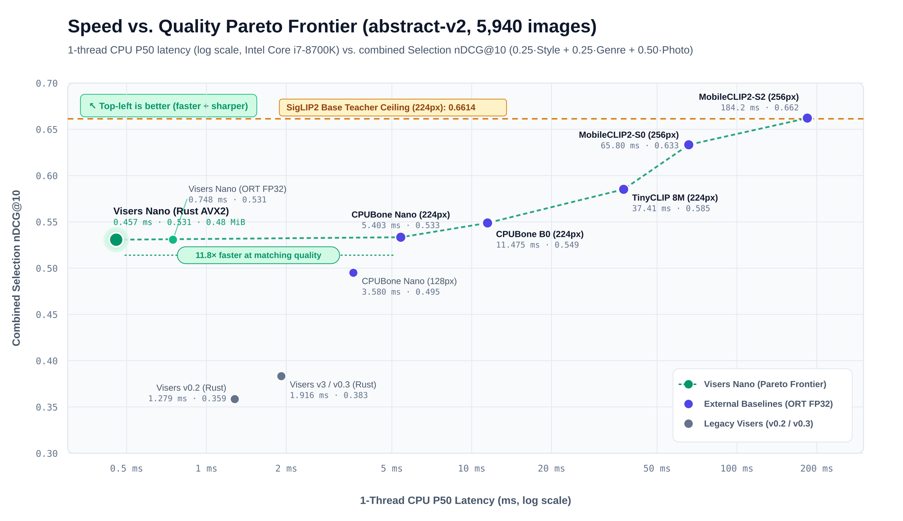
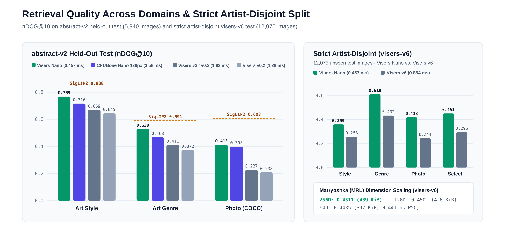

# Visers Nano — Benchmarks & Verification

All CPU timings were measured on **Intel Core i7-8700K @ 3.70 GHz** (Coffee Lake, AVX2/FMA, 32 KiB L1d / 256 KiB L2 per core, 12 MiB L3), pinned with `taskset`, excluding disk I/O and JPEG/PNG decoding.

---

## 1. Retrieval Quality

### A. `abstract-v2` Held-Out Test (`5,940` images: `1,686` art + `4,254` photo)

| Model | Backend | CPU P50 (ms) | Art Style | Art Genre | Cross-Genre Style | Photo (COCO) |
|---|---|---:|---:|---:|---:|---:|
| **Visers Nano (`W8`, `256D`)** | **Rust AVX2/FMA · 128px** | **0.457** | **0.7686** | **0.5291** | **0.6776** | **0.4126** |
| Visers v0.2 | Rust · 128px | 1.279 | 0.6451 | 0.3724 | — | 0.2082 |
| Visers v3 (`v0.3`) | Rust AVX2/FMA · 128px | 1.916 | 0.6688 | 0.4107 | 0.5888 | 0.2269 |
| CPUBone Nano (zero-shot) | ORT FP32 · 128px | 3.580 (2.634 tensor) | 0.7160 | 0.4675 | 0.6081 | 0.3982 |
| CPUBone Nano (zero-shot) | ORT FP32 · 224px | 5.403 | 0.7332 | 0.4883 | 0.6203 | 0.4560 |
| CPUBone B0 (zero-shot) | ORT FP32 · 224px | 11.475 | 0.7304 | 0.4843 | — | 0.4903 |
| TinyCLIP 8M | ORT FP32 · 224px | 37.405 | 0.7741 | 0.5363 | — | 0.5152 |
| MobileCLIP2-S0 | ORT FP32 · 256px | 65.803 | 0.7718 | 0.5707 | — | 0.5953 |
| MobileCLIP2-S2 | ORT FP32 · 256px | 184.226 | 0.8019 | 0.5916 | — | 0.6274 |
| SigLIP2 Base (teacher) | ViT-B/16 · 224px | — | 0.8380 | 0.5907 | — | 0.6084 |

### B. Strict Artist-Disjoint `visers-v6` Held-Out Test (`12,075` images: `9,576` art + `2,499` photo)

| Model | Dim | Precision | Art Style | Art Genre | Photo (COCO) | Selection Score |
|---|---:|---|---:|---:|---:|---:|
| Visers v6 (`both-s20261115`) | 256 | FP32 | 0.2575 | 0.4323 | 0.2444 | 0.2946 |
| **Visers Nano** | **256** | **W8** | **0.3587** | **0.6096** | **0.4181** | **0.4511** |
| **Visers Nano** | **128** | **W8** | — | — | — | **0.4501** |
| **Visers Nano** | **64** | **W8** | — | — | — | **0.4435** |

### C. Out-of-Distribution Generalization (`Flowers102`: `1,020` train / `6,149` test)

| Model | Dim | kNN-5 | Ridge Top-1 |
|---|---:|---:|---:|
| Previous `spatial-bottleneck` (trained from scratch) | 128 | 0.1807 | 0.2683 |
| **Visers Nano (`W8`)** | **256** | **0.3706** | **0.5269** |

---

## 2. Native Rust CPU Latency & Memory

640 warmed measurements (`128` images × `5` repeats) on `taskset -c 4` (1 thread) and `taskset -c 0-5` (`NanoSpinPool`, 6 threads, `2,560` images):

| Variant | Threads | Baked `.rodata` | P50 (ms) | P90 (ms) | P99 (ms) | Mean (ms) | Throughput (img/s) | Heap Allocs |
|---|---:|---:|---:|---:|---:|---:|---:|---:|
| `dim-256` | 1 | 500,572 B | **0.457** | 0.798 | 1.131 | 0.544 | **1,838.8** | **0** |
| `dim-64` | 1 | 406,876 B | **0.441** | 0.733 | 1.219 | 0.526 | **1,900.5** | **0** |
| `NanoSpinPool` (`dim-256`) | 6 | 500,572 B | **0.0935** | — | — | — | **10,083.2** | **0** |

### Per-Stage Breakdown (`dim-256`, `--profile`, 640 runs)

| Stage | MACs | Time (µs) | Share |
|---|---:|---:|---:|
| Fused `conv_stem` (`3→32`) + `blocks.0.0` (`32→16`) + `u8→f32` LUT | 8.26M | 181.4 | 30.5% |
| Pointwise `1×1` (28 layers) | 9.65M | 228.7 | 38.5% |
| Depthwise `3×3` / `5×5` (14 layers) | 0.84M | 107.0 | 18.0% |
| `conv3x3` (`blocks.1.0`, `16→48`) | 1.77M | 61.7 | 10.4% |
| Global Avg Pool + `Linear(480→256)` + L2 norm | 0.12M | 15.8 | 2.7% |

---

## 3. PyTorch `W8` ↔ Native Rust Numerical Parity

Measured across all 128 canonical `128×128` RGB images in `validation.rgb` (with `FTZ | DAZ` enabled in Rust):

| Matryoshka Dim | Max Abs Error | Min Cosine Similarity |
|---:|---:|---:|
| `256` | `8.34e-7` | `0.99999946` |
| `128` | `8.94e-7` | `0.99999952` |
| `64` | `8.94e-7` | `0.99999970` |
