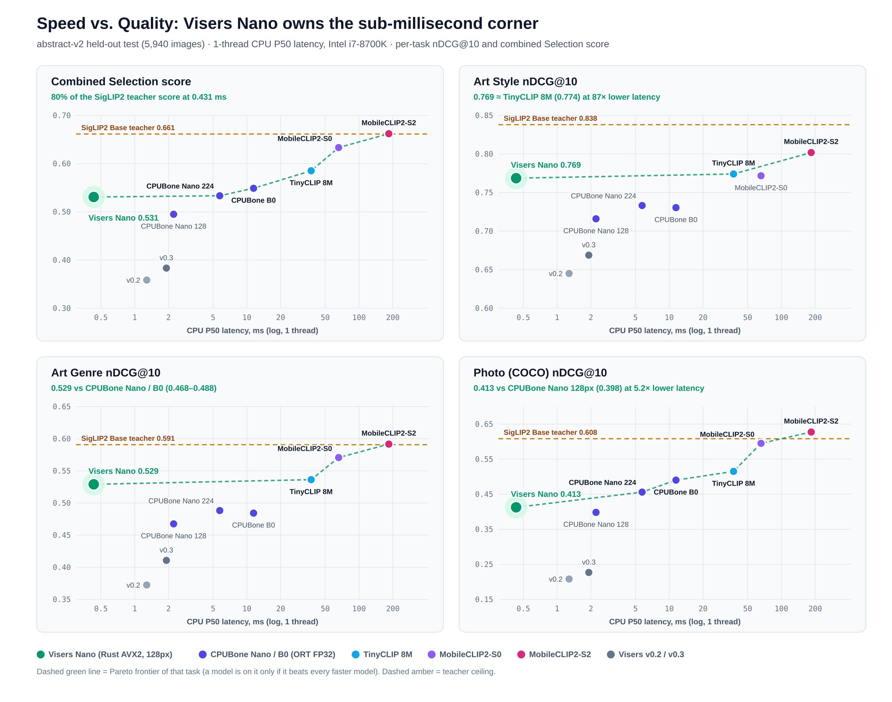

# Visers Nano

**Sub-millisecond CPU visual embeddings in pure Rust.**  
`0.431 ms` P50 per `128×128` RGB image · `13,224 img/s` on 6 cores · `0` heap allocations · `489 KiB` weights embedded in `.rodata`.



`visers-nano` distills a `SigLIP2 Base` vision teacher into a quantization-aware `MobileNetV4-Conv-Small-0.50` backbone (`W8` symmetric per-channel weights + Matryoshka `256D` / `128D` / `64D` head) and compiles it into a dependency-free Rust crate with hand-tuned **AVX2 + FMA** kernels, fused RGB-to-uint8/float stem, and a **zero-allocation `NanoSpinPool`**.

Visers Nano's approach to embedding model weights at compile time was inspired by [`flowercomputers/encoders`](https://github.com/flowercomputers/encoders).

---

## Quick Start

Add `visers-nano` to your `Cargo.toml` (weights are compiled directly into the binary — no external model files or ONNX Runtime needed):

```toml
[dependencies]
visers-nano = { git = "https://github.com/0himera/visers-nano" }
```

Encode a `128×128×3` interleaved `RGB` (`u8`) image into an L2-normalized embedding:

```rust
use visers_nano::{encode_single_rgb, RGB_BYTES};

fn main() -> Result<(), &'static str> {
    let rgb = vec![128u8; RGB_BYTES];
    let embedding = encode_single_rgb(&rgb)?;
    let norm_sq = embedding.iter().map(|x| x * x).sum::<f32>();
    println!("dim={}, norm_sq={norm_sq:.6}", embedding.len());
    Ok(())
}
```

> **Always run in `--release` mode.** Debug builds disable SIMD inlining and are ~15× slower.

Reuse a `NanoWorkspace` and output buffers for allocation-free encoding. A persistent `NanoSpinPool` can encode a batch across multiple cores.

```rust
use std::sync::Arc;
use visers_nano::{NanoEncoder, NanoSpinPool, RGB_BYTES};

fn main() -> Result<(), &'static str> {
    let first = vec![128u8; RGB_BYTES];
    let second = vec![192u8; RGB_BYTES];
    let images = [first.as_slice(), second.as_slice()];

    let encoder = Arc::new(NanoEncoder::baked()?);
    let mut workspace = encoder.workspace();
    let dim = encoder.embedding_dim();

    let mut out = vec![0.0; dim];
    encoder.encode_rgb(images[0], &mut workspace, &mut out)?;

    // Six threads total, including the caller. Output vectors follow input order.
    let pool = NanoSpinPool::new(encoder, 6);
    let mut batch_out = vec![0.0; images.len() * dim];
    pool.encode_batch(&images, &mut workspace, &mut batch_out)?;
    Ok(())
}
```

---

## Why Visers Nano?

- **Zero runtime dependencies:** No ONNX Runtime, no PyTorch/libtorch, no Python, no filesystem I/O at startup.
- **Sub-millisecond CPU latency** with `0.431 ms` P50 and `2,268 img/s` on one core. Six cores reach `13,224 img/s`.
- **4.4× lower P50 latency and +0.147 selection score vs `Visers v0.3`** with a `SigLIP2`-distilled `MobileNetV4` trunk.
- **13.1× the single-core throughput of `CPUBone Nano (224px)`** at similar retrieval quality (`0.531` vs `0.533` selection score).
- **Matryoshka (MRL) dimension flags:** Select `dim-256` (default, `489 KiB`), `dim-128` (`428 KiB`), or `dim-64` (`397 KiB`) at compile time.
- **Portable x86_64 + scalar fallback:** Uses `is_x86_feature_detected!("avx2")` + `fma` at runtime and automatically falls back to scalar code on non-AVX2 CPUs.

---

## Benchmarks

### Retrieval Quality & Latency (`abstract-v2`, 5,940 images)

CPU latency uses a single thread on **Intel Core i7-8700K @ 3.70 GHz**. Timings include preprocessing from in-memory RGB and inference. Retrieval scores use the `abstract-v2` held-out test. See [BENCHMARKS.md](BENCHMARKS.md) for the timing corpus and CPU affinity.

| Model | Backend | CPU P50 (ms) | Art Style | Art Genre | Cross-Genre | Photo (COCO) |
|---|---|---:|---:|---:|---:|---:|
| **Visers Nano (`W8`, `256D`)** | **Rust AVX2 · 128px** | **0.431** | **0.7686** | **0.5291** | **0.6776** | **0.4126** |
| Visers Nano (`W8`, `256D`) | ORT FP32 · 128px | 0.537 | 0.7686 | 0.5291 | 0.6776 | 0.4126 |
| Visers v0.2 | Rust · 128px | 1.279 | 0.6451 | 0.3724 | — | 0.2082 |
| Visers v3 (`v0.3`) | Rust AVX2 · 128px | 1.916 | 0.6688 | 0.4107 | 0.5888 | 0.2269 |
| CPUBone Nano | ORT FP32 · 128px | 2.222 | 0.7160 | 0.4675 | 0.6081 | 0.3982 |
| CPUBone Nano | ORT FP32 · 224px | 5.727 | 0.7332 | 0.4883 | 0.6203 | 0.4560 |
| CPUBone B0 | ORT FP32 · 224px | 11.475 | 0.7304 | 0.4843 | — | 0.4903 |
| TinyCLIP 8M | ORT FP32 · 224px | 37.405 | 0.7741 | 0.5363 | — | 0.5152 |
| MobileCLIP2-S0 | ORT FP32 · 256px | 65.803 | 0.7718 | 0.5707 | — | 0.5953 |
| MobileCLIP2-S2 | ORT FP32 · 256px | 184.226 | 0.8019 | 0.5916 | — | 0.6274 |
| *SigLIP2 Base (Teacher)* | *ViT-B/16 · 224px* | *—* | *0.8380* | *0.5907* | *—* | *0.6084* |


### Runtime Throughput & Per-Stage Profile


See [BENCHMARKS.md](BENCHMARKS.md) for full `visers-v6` artist-disjoint metrics, `Flowers102` OOD linear-probe scores, and FP32-vs-Rust parity checks.

---

## Cargo Features

| Feature | Embedding Dim | `.rodata` Weights | Rust vs FP32 Max Diff |
|---|---:|---:|---:|
| `dim-256` *(default)* | `256` | `500,572 B` (`489 KiB`) | `8.34e-7` |
| `dim-128` | `128` | `438,556 B` (`428 KiB`) | `8.94e-7` |
| `dim-64` | `64` | `406,876 B` (`397 KiB`) | `8.94e-7` |

```toml
# Example: 64D embeddings (397 KiB weights, 0.441 ms P50)
visers-nano = { git = "https://github.com/0himera/visers-nano", default-features = false, features = ["dim-64", "simd"] }
```

## CLI & Benchmarks

`corpus.rgb` contains one or more consecutive `128×128×3` RGB frames. The output file contains consecutive little-endian `f32` embedding vectors.

```bash
# Benchmark single-thread and six-thread inference
cargo run --release --example nano_rgb -- corpus.rgb --bench
cargo run --release --example nano_rgb -- corpus.rgb --bench-batch 6

# Print per-stage timings with AVX2/FMA
cargo run --release --example nano_rgb -- corpus.rgb --profile

# Encode the corpus to a file
cargo run --release --example nano_rgb -- corpus.rgb embeddings.f32
```

## Architecture

See [ARCHITECTURE.md](ARCHITECTURE.md) for the `VSN1` weight format, SIMD kernels, and batch execution.

## License

Licensed under the [Apache License, Version 2.0](LICENSE).
