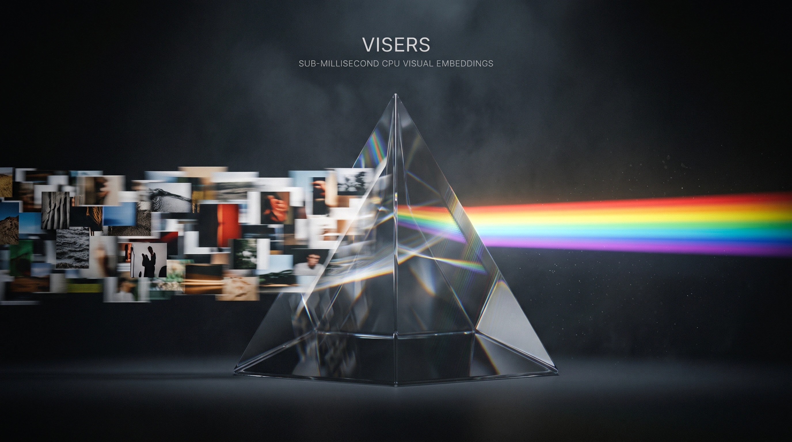
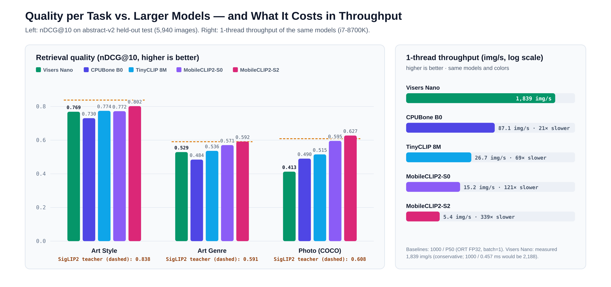
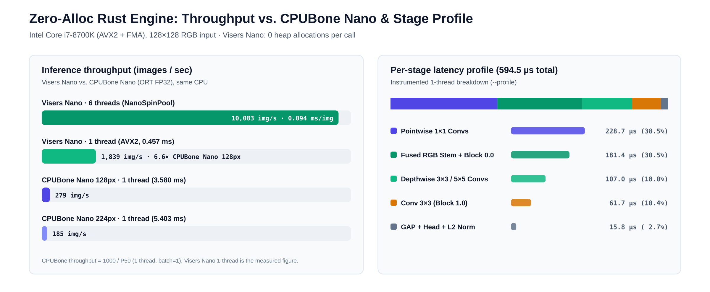

# Visers <a href="https://huggingface.co/0himera/visers-nano"></a>

**Visers** is a Rust CPU inference engine for visual embeddings with native Rust and Python APIs.

The included **Nano** model encodes `128×128` RGB images into L2-normalized vectors.

The current 256D encoder takes **0.399 ms P50** per in-memory `128×128` RGB image on one i7-8700K core. It performs zero steady-state heap allocations and embeds 489 KiB of weights. [RGB benchmark](BENCHMARKS.md#single-core-rgb-inference)

Nano uses a `MobileNetV4-Conv-Small-0.50` backbone distilled from `SigLIP2 Base` with symmetric per-channel `W8` weights and a Matryoshka `256D` / `128D` / `64D` head. The dependency-free Rust runtime uses hand-tuned **AVX2 + FMA** kernels, a fused RGB stem, and a **zero-allocation `NanoSpinPool`**.

Visers approach to embedding model weights at compile time was inspired by [`flowercomputers/encoders`](https://github.com/flowercomputers/encoders).

[Quick Start](#quick-start) · [Python API](bindings/python/README.md) · [Image Files](#image-files) · [Benchmarks](#benchmarks) · [Batch Encoding](#batch-encoding) · [Cargo Features](#cargo-features) · [Architecture](ARCHITECTURE.md)

---

## Quick Start

### Python

Install Visers from PyPI in a Python 3.10 or newer environment.

```bash
python -m pip install visers
```

```python
from pathlib import Path
import visers as nano

image = Path("assets/banner.webp")
embedding = nano.encode_single(image)                     # (256,)
batch = nano.encode([image, image.read_bytes()], jobs=2)  # (2, 256)
print(nano.similarity(embedding, batch[1]))
```

Both calls return NumPy `float32` arrays. Use `mode="full"` to match Forge preprocessing. Installation, input types, batch errors and build-time dimensions are covered in the [Python API guide](bindings/python/README.md).

### Rust

Enable `image-files` to encode paths or encoded bytes directly. For a sibling checkout, add this dependency to your application's `Cargo.toml`.

```toml
[dependencies]
visers = { package = "visers-nano", path = "../visers-nano", features = ["image-files"] }
```

```rust
use visers::{encode, encode_single, similarity};

fn main() -> Result<(), Box<dyn std::error::Error>> {
    let query = encode_single("assets/banner.webp")?;
    let rows = encode(["assets/banner.webp", "assets/domain-comparison.png"])?;
    println!("cosine = {:.4}", similarity(&query, &rows[0])?);
    Ok(())
}
```

Paths resolve against the process working directory. Run the examples from the Visers checkout to use its bundled images. The default Rust build accepts packed 128×128 RGB directly through `encode_single_rgb` and `encode_batch_rgb`. Use release builds to measure inference speed.

---

## Image Files

Build the optional file pipeline and pass images directly to the CLI. It recognizes JPEG, PNG, WebP, GIF, BMP and PNM by their contents. Each output is an L2-normalized Nano embedding.

```bash
cargo build --release --features image-files --bin nano_image
target/release/nano_image assets/banner.webp
target/release/nano_image --jobs 2 --profile -o embeddings.f32 assets/banner.webp assets/domain-comparison.png
```

The CLI prints one JSON array per input in argument order. With `-o`, a batch writes consecutive little-endian `f32` vectors in the same order. `--profile` reports file read, decode, resize and inference times to stderr.

The default fast mode uses fractional JPEG decoding and decoder-side scaling for opaque still WebP. Add `--full` to reproduce the Forge preprocessing with full-resolution decode, EXIF orientation, RGB conversion and Pillow 13 BOX resizing of the whole frame to 128×128. Both modes discard alpha and use the first frame of GIF and animated WebP. Use one preprocessing mode consistently when building and querying an index.

| Rust call with `image-files` | Result |
|---|---|
| `encode_single(input)` | One `[f32; DIMENSIONS]` from a path or encoded bytes |
| `encode(inputs)` | Ordered, contiguous rows in fast mode, using available cores |
| `encode_into(input, &mut out)` | Writes one row into an existing buffer and returns stage timings |
| `encode_with_options(&inputs, mode, jobs)` | Ordered rows from any mix of `ImageInput::Path` and `ImageInput::Bytes`, with explicit preprocessing and worker count |

Both batch calls return the lowest failing input index on error. For per-file results, use `image_io::encode_files`. Run `cargo doc --features image-files --open` for the full Rust API.

For a caller-managed model, keep a pipeline and an output buffer across calls.

```rust
use visers::{image_io::DecodeMode, NanoEncoder};

fn main() -> Result<(), Box<dyn std::error::Error>> {
    let model = NanoEncoder::baked()?;
    let mut pipeline = model.image_pipeline(DecodeMode::Fast);
    let mut embedding = vec![0.0; model.embedding_dim()];
    pipeline.encode_file("assets/banner.webp", &mut embedding)?;

    let upload = std::fs::read("assets/domain-comparison.png")?;
    let timings = pipeline.encode_bytes(&upload, &mut embedding)?;
    println!("decode took {:?}", timings.decode);
    Ok(())
}
```

For multiple files, `image_io::encode_files(&model, &paths, mode, jobs)` accepts a `NonZeroUsize` worker count and returns an ordered result for each input. Each worker owns its decoder, pixel buffers and inference workspace.

The bundled codecs need a C compiler and CMake. Install NASM before building on x86 for JPEG SIMD, or use an installed libturbojpeg 3.x with `TURBOJPEG_SOURCE=pkg-config TURBOJPEG_DYNAMIC=1 cargo build --release --features image-files --bin nano_image`. The default RGB library has no external crate dependencies.

---

## Benchmarks

### Retrieval Quality & Latency (`abstract-v2`, 5,940 images)

The Visers Nano figures in the charts and retrieval table below use the published `v1.0.0` build. CPU latency uses a single thread on **Intel Core i7-8700K @ 3.70 GHz** and includes preprocessing from in-memory RGB and inference. Retrieval scores use the `abstract-v2` held-out test. See [BENCHMARKS.md](BENCHMARKS.md) for the timing corpus and CPU affinity.




### Runtime Throughput & Per-Stage Profile



### Detailed Retrieval Results

| Model | Backend | CPU P50 (ms) | Art Style | Art Genre | Cross-Genre | Photo (COCO) |
|---|---|---:|---:|---:|---:|---:|
| **Visers Nano (`W8`, `256D`)** | **Rust AVX2 · 128px** | **0.431** | **0.7686** | **0.5291** | **0.6776** | **0.4126** |
| Visers Nano (`W8`, `256D`) | ORT FP32 · 128px | 0.537 | 0.7686 | 0.5291 | 0.6776 | 0.4126 |
| Visers v0.2 | Rust · 128px | 1.279 | 0.6451 | 0.3724 | — | 0.2082 |
| Visers v3 (`v0.3`) | Rust AVX2 · 128px | 1.916 | 0.6688 | 0.4107 | 0.5888 | 0.2269 |
| CPUBone Nano | ORT FP32 · 128px | 2.222 | 0.7160 | 0.4675 | 0.6081 | 0.3982 |
| CPUBone Nano | ORT FP32 · 224px | 5.727 | 0.7332 | 0.4883 | 0.6203 | 0.4560 |
| CPUBone B0 | ORT FP32 · 224px | 11.475 | 0.7304 | 0.4843 | — | 0.4903 |
| TinyCLIP 8M | ORT FP32 · 224px | 37.405 | 0.7741 | 0.5363 | — | 0.5152 |
| MobileCLIP2-S0 | ORT FP32 · 256px | 65.803 | 0.7718 | 0.5707 | — | 0.5953 |
| MobileCLIP2-S2 | ORT FP32 · 256px | 184.226 | 0.8019 | 0.5916 | — | 0.6274 |
| *SigLIP2 Base (Teacher)* | *ViT-B/16 · 224px* | *—* | *0.8380* | *0.5907* | *—* | *0.6084* |

See [BENCHMARKS.md](BENCHMARKS.md) for full `visers-v6` artist-disjoint metrics, `Flowers102` OOD linear-probe scores, and FP32-vs-Rust parity checks.

---

## Batch Encoding

Reuse a `NanoWorkspace` and output buffers for allocation-free encoding. A persistent `NanoSpinPool` can encode a batch across multiple cores.

```rust
use std::sync::Arc;
use visers::{NanoEncoder, NanoSpinPool, RGB_BYTES};

fn main() -> Result<(), &'static str> {
    let first = vec![128u8; RGB_BYTES];
    let second = vec![192u8; RGB_BYTES];
    let images = [first.as_slice(), second.as_slice()];

    let encoder = Arc::new(NanoEncoder::baked()?);
    let mut workspace = encoder.workspace();
    let dim = encoder.embedding_dim();

    let mut out = vec![0.0; dim];
    encoder.encode_rgb(images[0], &mut workspace, &mut out)?;

    // Six threads total, including the caller. Output vectors follow input order.
    let pool = NanoSpinPool::new(encoder, 6);
    let mut batch_out = vec![0.0; images.len() * dim];
    pool.encode_batch(&images, &mut workspace, &mut batch_out)?;
    Ok(())
}
```

---

## Why Visers Nano?

- **Standalone Rust inference.** The packed-RGB engine uses the Rust standard library and its embedded model weights.
- **Release throughput.** The `v1.0.0` RGB build measured `2,268 img/s` on one core and `13,224 img/s` on six.
- **4.4× lower P50 latency and +0.147 selection score vs `Visers v0.3`** with a `SigLIP2`-distilled `MobileNetV4` trunk.
- **13.1× the single-core throughput of `CPUBone Nano (224px)`** at similar retrieval quality (`0.531` vs `0.533` selection score).
- **Matryoshka (MRL) dimension flags:** Select `dim-256` (default, `489 KiB`), `dim-128` (`428 KiB`), or `dim-64` (`397 KiB`) at compile time.
- **Portable x86_64 + scalar fallback:** Uses `is_x86_feature_detected!("avx2")` + `fma` at runtime and automatically falls back to scalar code on non-AVX2 CPUs.

---

## Cargo Features

| Feature | Embedding Dim | `.rodata` Weights | Rust vs FP32 Max Diff |
|---|---:|---:|---:|
| `dim-256` *(default)* | `256` | `500,572 B` (`489 KiB`) | `8.34e-7` |
| `dim-128` | `128` | `438,556 B` (`428 KiB`) | `8.94e-7` |
| `dim-64` | `64` | `406,876 B` (`397 KiB`) | `8.94e-7` |

```toml
# Example: 64D embeddings (397 KiB baked weights)
visers = { package = "visers-nano", git = "https://github.com/0himera/visers", default-features = false, features = ["dim-64", "simd"] }
```

## CLI & Benchmarks

`corpus.rgb` contains one or more consecutive `128×128×3` RGB frames. The output file contains consecutive little-endian `f32` embedding vectors.

```bash
# Benchmark single-thread and six-thread inference
cargo run --release --example nano_rgb -- corpus.rgb --bench
cargo run --release --example nano_rgb -- corpus.rgb --bench-batch 6

# Print per-stage timings with AVX2/FMA
cargo run --release --example nano_rgb -- corpus.rgb --profile

# Encode the corpus to a file
cargo run --release --example nano_rgb -- corpus.rgb embeddings.f32
```

## Architecture

See [ARCHITECTURE.md](ARCHITECTURE.md) for the `VSN1` weight format, SIMD kernels, and batch execution.

## Releases

GitHub Actions tests pull requests and builds Python distributions on pushes to `main` and version tags. An annotated `v<version>` tag matching the workspace version publishes the tested wheels and source distribution to PyPI. The GitHub release includes those files, the Linux x86-64 `nano_rgb` CLI and the benchmark charts. [PyPI](https://pypi.org/project/visers/) · [GitHub releases](https://github.com/0himera/visers/releases)

PyPI Trusted Publishing uses the `pypi` environment in `.github/workflows/ci.yml` from `0himera/visers`.

## License

Licensed under the [Apache License, Version 2.0](LICENSE).
